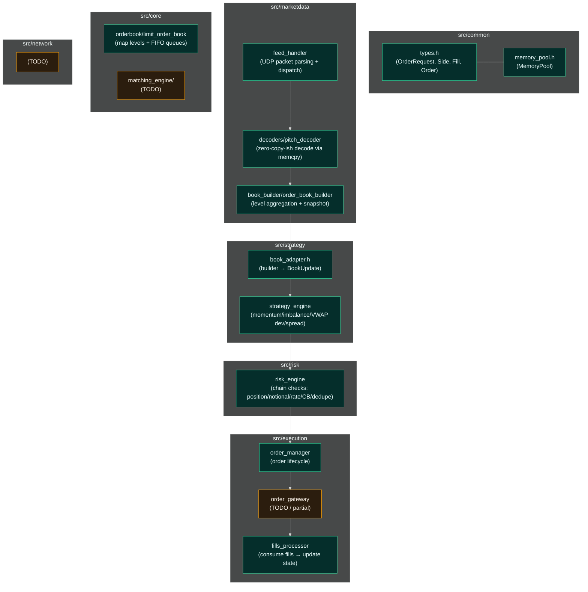
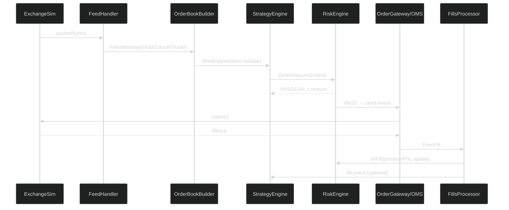

# High-Frequency-Trading-Engine (C++)

An end-to-end **HFT-style trading system simulator** in modern C++: market-data ingest → book building → strategy → pre-trade risk → execution → fills → PnL/positions.  
Goal: build a correct system first, then make it low-latency with measurements.

---

## Architecture (big picture)

```mermaid
flowchart LR
  %% Theme hints (rendered by GitHub-compatible Mermaid)
  %%{init: {'flowchart': {'curve': 'basis'}, 'theme': 'dark'} }%%

  EX[Exchange Simulator\n(venue)] -->|market data| MD[Market Data\nFeed Handler + Decoder]
  MD --> BB[Order Book Builder\n(reconstruct book)]
  BB --> ST[Strategy Engine\n(signals → intents)]
  ST --> RK[Risk Engine\n(pre-trade checks)]
  RK --> GW[Order Gateway / OMS\n(send orders)]
  GW -->|orders| EX
  EX -->|fills / acks| GW
  GW --> FP[Fills Processor\n(update positions/PnL)]
  FP --> RK
  FP --> ST

  classDef core fill:#1f2937,stroke:#93c5fd,stroke-width:1px,color:#e5e7eb;
  classDef hot fill:#111827,stroke:#f59e0b,stroke-width:1px,color:#f9fafb;
  classDef io fill:#0b1220,stroke:#34d399,stroke-width:1px,color:#ecfeff;

  class MD,BB,ST,RK hot;
  class EX,GW,FP io;
```

---

## What’s implemented (current repo state)



---

## Data flow (tick → trade)



---

## Build & run (today)

This repo currently emphasizes **component correctness** with standalone unit tests (no external framework).

Example (limit order book unit tests):

```bash
g++ -std=c++17 tests/unit/test_limit_order_book.cpp \
  src/core/orderbook/limit_order_book.cpp \
  -o test_lob && ./test_lob
```

> Roadmap includes adding a full build system (CMake), CI, sanitizers, benchmarks, and end-to-end apps. See `PROJECT_PLAN.txt`.

---

## Project roadmap (high level)

- **Correctness first**: limit order book + matching engine + replayable tests
- **End-to-end loop**: exchange simulator + gateway + fills + positions/PnL
- **Low-latency engineering**: lock-free queues, cache-friendly book, no hot-path allocations
- **Measurement**: tick-to-trade latency histograms (p50/p99/p99.9) and microbenchmarks

For the detailed plan, see `PROJECT_PLAN.txt`.

